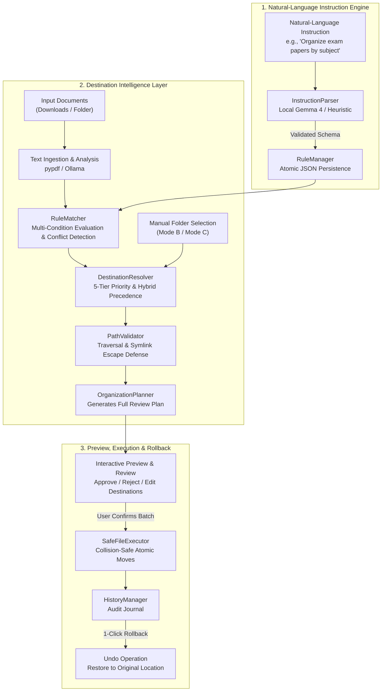
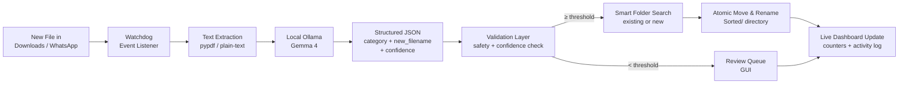

# SortSense — Gemma Local File Organizer

> An offline, privacy-first desktop application that automatically reads, semantically categorises, and organises incoming downloads using a locally running **Gemma 4** model — zero cloud, zero uploads.

## Team

**Team Name:** Brute Force

| Member | Contribution |
| ------ | ------------ |
| **Dev Madhav** | File watcher daemon (`watchdog`), multi-browser download path detection, OS directory routing, atomic file move & rename engine |
| **Aadi UR** | Document extraction pipeline (`pypdf`, plain-text / OCR), metadata sanitisation, GUI pipeline integration & live counter wiring |
| **Jeevan T** | Local Gemma 4 integration via Ollama, structured JSON prompt engineering, confidence-threshold validation layer |
| **Rohith Singothu** | CustomTkinter desktop dashboard (Obsidian/Emerald theme), setup scripts (`setup.sh` / `setup.bat`), documentation & MLH submission |

## Problem Statement

### The Problem

Every day, developers, students, and professionals receive dozens of untracked files through messaging platforms such as WhatsApp and web browsers. These files land in default `Downloads` directories with non-descriptive names:

```text
IMG-20261008-WA0004.pdf
DOC-WA0012.pdf
a8f31c92.pdf
```

Users waste substantial time manually sorting, renaming, and hunting through gigabytes of unorganised files.

### Why We Chose This Problem

Existing file organisers rely on rigid extension-based rules:

```
.pdf → Documents/    .jpg → Pictures/    .mp4 → Videos/
```

This cannot understand the *meaning* of a document — two `.pdf` files could be an electricity bill or a university syllabus. Cloud-based AI tools solve this but require uploading potentially sensitive documents (bank statements, identity papers, medical records) to external servers. **SortSense solves this locally.**

## Solution

SortSense is a lightweight background daemon combined with a live desktop dashboard. When a new document arrives in any watched folder:

1. **Detect** — `watchdog` fires a filesystem event instantly.
2. **Extract** — `pypdf` or plain-text extraction pulls the document's content.
3. **Classify** — Extracted text is sent to a locally running **Gemma 4** model via Ollama.
4. **Validate** — A deterministic Python validation layer checks the structured JSON response for safety and confidence.
5. **Organise** — The file is atomically renamed and moved into the correct category subfolder, with smart deduplication if the folder already exists.
6. **Display** — The desktop GUI updates its counters, Activity Log, and Review Queue in real time.

All processing stays on the user's machine.

### Key Features

- **Semantic understanding** — classifies by *content*, not just extension.
- **Intent-Driven Natural Language Engine** — express complex organization rules in plain English (e.g., *"Move all examination question papers from this academic year into Examination Papers"*).
- **Three Organization Modes** — Mode A (AI-Directed), Mode B (Manual Destination), and Mode C (Hybrid - Default).
- **100% offline & private** — Gemma 4 runs via local Ollama; zero telemetry, zero cloud uploads.
- **Pre-Execution Organization Preview** — full inspection of routing plans, confidence scores, detected academic years, and warnings with per-file approve/reject/edit controls before any files move.
- **Deterministic Safe File Execution** — path-traversal & symlink escape guards, collision-safe automatic suffixing, and no silent overwrites.
- **Full History & 1-Click Rollback** — persistent operation journal enabling instant undo of executed batches.
- **Academic Year Intelligence** — configurable academic year start month separating institutional academic years from simple calendar years.
- **Intelligent auto-renaming** — transforms `DOC-WA0012.pdf` → `Electricity_Bill_September_2026.pdf`.
- **Smart folder matching** — finds and reuses existing category folders instead of creating duplicates.
- **Multi-browser watch** — auto-detects Chrome, Firefox, and OS-default download paths on Windows and Linux.
- **Review Queue** — low-confidence files are surfaced in the GUI for manual one-click placement.
- **Live dashboard** — real-time Files Processed, Pending Review, and Model Status counters.

## Innovation and Differentiation

Traditional organisers match extensions. SortSense reads the document, asks a local LLM what it means, and files it semantically:

```
Electricity bill PDF  →  Gemma 4  →  Utilities/Electricity_Bill_September_2026.pdf
Signals & Systems notes  →  Gemma 4  →  Study_Notes/Signals_Systems_Semester_Notes.pdf
```

The key differentiators are:

- **Local edge inference** — open-weight Gemma 4 runs on-device; no API costs or internet dependency.
- **Confidence guardrails** — files below the configurable confidence threshold go to a Review Queue instead of being silently misplaced.
- **Structured + validated output** — Gemma is prompted for strict JSON; a Python layer blocks path-traversal characters, wrong extensions, and empty responses before any filesystem operation.
- **Smart existing-folder reuse** — scans the output directory for a matching subfolder before creating a new one, preventing fragmentation.

## Technical Implementation

### Architecture

#### Intent-Driven Organization & Destination Intelligence Pipeline



#### Background Automated Watcher Pipeline



### Technology Stack

| Category | Technologies |
| -------- | ------------ |
| Frontend | CustomTkinter desktop GUI (Obsidian/Emerald theme) with Intent & Preview panes |
| Backend | Python 3.13, Pydantic v2, `watchdog`, `shutil` |
| Persistence | Atomic local JSON journals (`rules.json`, `history.json`) — zero cloud |
| AI / ML | Gemma 4 (`gemma4:e4b`) via Ollama, structured JSON prompting & heuristics |
| Infrastructure | Local Ollama daemon, OS filesystem APIs |
| APIs / Services | N/A — fully offline, zero telemetry |

### How It Works

| Layer | Module | Responsibility |
| ----- | ------ | -------------- |
| Watcher | `app/watcher.py` + `app/browser_paths.py` | Detects Chrome, Firefox & OS-default download paths; fires `FileEvent` on new files |
| Ingestion | `app/ingestion.py` | Extracts text from `.pdf`, `.txt`, `.md` using `pypdf` |
| Analyser | `app/analyzer.py` | Sends extracted text to Ollama, parses `DocumentAnalysis` JSON |
| Validation | `app/validation.py` | Blocks path-traversal, wrong extensions, null bytes; returns `ValidationResult` |
| Instruction Parser | `app/intent/instruction_parser.py` | Converts natural-language instructions into validated Pydantic rules |
| Rule Manager | `app/intent/rule_manager.py` | Thread-safe atomic JSON persistence for user rules (CRUD, enable/disable) |
| Rule Matcher | `app/intent/rule_matcher.py` | Evaluates document metadata against saved rules with conflict detection |
| Destination Resolver | `app/intent/destination_resolver.py` | Resolves target directories according to 5-tier priority and mode precedence |
| Folder Browser | `app/intent/folder_browser.py` | Safe browsing and programmatic directory creation |
| Path Validator | `app/intent/path_validator.py` | Validates target paths against traversal, null bytes, reserved names, and symlinks |
| Planner | `app/intent/planner.py` | Compiles batch organization preview with explanations and confidence scores |
| Safe Executor & Undo | `app/intent/executor.py` | Collision-safe file movements, operation logging, and 1-click rollback |
| GUI | `app/gui.py` | CustomTkinter dashboard with Intent Selector, Preview, and History tabs |
| Config | `app/config.py` | Pydantic `Settings` singleton; all values overridable via env vars |

### Technical Decisions

- **Threading model** — the watcher fires events on a background thread; each file's pipeline runs on its own daemon thread; all Tkinter widget updates are marshalled back to the main thread via `self.after(0, ...)` to avoid race conditions.
- **Pydantic v2 for all data models** — `DocumentAnalysis`, `ValidationResult`, `OrganizationRule`, `OrganizationPlan`, and `OperationRecord` are frozen Pydantic models, making invalid states unrepresentable.
- **Confidence threshold** — configurable via `FILEMIND_CONFIDENCE_THRESHOLD` env var (default `0.85`). Files below threshold are flagged for human review rather than silently misrouted.
- **Collision-safe moves** — destination files are never overwritten; the router appends `_1`, `_2` … suffixes automatically.
- **Local JSON persistence** — rules and operation audit logs use atomic writes with `.tmp` swapping for crash resilience with zero server or database overhead.

## Intent-Driven AI File Organization Engine

SortSense features an intent-driven organization architecture, allowing users to control file organization through natural-language prompts, manual folder pickers, or a hybrid combination of both.

### Three Organization Modes

| Mode | Identifier | Description | Example Workflow |
| ---- | ---------- | ----------- | ---------------- |
| **Mode A: AI-Directed** | `ai_directed` | The user provides a high-level natural language instruction. Gemma analyzes file content, identifies document types, subjects, and dates, and proposes a complete folder hierarchy. | *"Organize all my college documents by subject and semester."* &rarr; Proposes `College/<Subject>/<Semester>/` hierarchy. |
| **Mode B: Manual Destination** | `manual_destination` | The user chooses the destination folder via folder picker. The AI identifies matching files and routes them directly to the chosen folder. | User selects `D:/College/Exam Papers/` and instructs *"Find all 2026 exam papers"*. |
| **Mode C: Hybrid (Default)** | `hybrid` | The user provides an instruction **and** manually selects a root destination folder. The manually selected root takes strict precedence, while AI organizes subfolders inside it. | User selects `D:/College/Exam Papers/` with instruction *"Move exam papers by subject"*. &rarr; Files go to `D:/College/Exam Papers/<Subject>/`. |

### Natural-Language Instruction Engine

The instruction engine (`InstructionParser`) converts freeform text instructions into validated Pydantic rule models.

#### Structured Schema

```json
{
  "rule_name": "Current Year Examination Papers",
  "conditions": {
    "document_types": ["question_paper", "exam_paper"],
    "academic_year": "2026",
    "subjects": [],
    "keywords": [],
    "file_extensions": [".pdf", ".txt", ".md"],
    "min_confidence": 0.7
  },
  "destination": {
    "root": "Examination Papers",
    "subfolder_pattern": null,
    "group_by": ["subject"]
  },
  "rename": false,
  "enabled": true
}
```

#### Canonical Examples Handled

1. **Academic Year Exam Papers:**
   > *"Move all examination question papers from this academic year into Examination Papers."*
   > - Matches document types `["exam_paper", "question_paper"]`
   > - Automatically derives academic year (e.g., `2025-2026`) based on institutional start month.
   > - Routes to `Examination Papers/`.
2. **Programming Assignments:**
   > *"Put all Python programming assignments into my Programming folder."*
   > - Filters for assignments matching `Python` keywords.
   > - Routes to `Programming/`.
3. **Invoices by Company and Year:**
   > *"Organize invoices by company and year."*
   > - Matches `invoice` types; groups by company and calendar year (`Invoices/<Company>/<Year>/`).
4. **NLP Research Papers:**
   > *"Move all research papers related to NLP into my Research folder."*
   > - Filters research papers with NLP keywords into `Research/`.
5. **Certificates:**
   > *"Keep all certificates in a separate folder."*
   > - Isolates certifications and awards into `Certificates/`.
6. **Lecture Notes:**
   > *"Organize lecture notes by subject and semester."*
   > - Groups lecture notes dynamically by detected subject and semester (`Notes/<Subject>/<Semester>/`).

#### Ambiguity Detection & Clarification

If an instruction is incomplete or ambiguous (e.g., *"Move files somewhere"*), `InstructionParser` identifies missing constraints and generates specific clarification questions instead of guessing.

#### Academic Year Intelligence

In academic environments, academic years (e.g. 2025–2026) cross calendar year boundaries. SortSense includes `AcademicYearConfig` with a configurable institutional start month (default August, month 8). A document dated October 2025 correctly maps to academic year `2025-2026`, rather than being misclassified into calendar year 2025.

### Destination Intelligence Layer

The Destination Intelligence Layer separates concerns into dedicated, single-responsibility modules:

1. **`InstructionParser`** — Converts natural language into validated `OrganizationRule` models.
2. **`RuleManager`** — Thread-safe atomic JSON store (`rules.json`) supporting CRUD and enable/disable toggling.
3. **`RuleMatcher`** — Evaluates document metadata (type, subject, keywords, academic year, semester) against saved rules and flags rule conflicts.
4. **`DestinationResolver`** — Resolves final target paths according to strict 5-tier priority:
   1. *Explicit manual destination* for current operation.
   2. *Matching saved user rule*.
   3. *AI-generated category suggestion*.
   4. *Existing default category folder*.
   5. *Review queue fallback*.
5. **`FolderBrowser`** — Safe cross-platform directory browsing and creation.
6. **`PathValidator`** — Guards against directory traversal (`../`), null bytes, Windows reserved device names (`CON`, `PRN`, `AUX`, `NUL`), and symlink escapes.
7. **`OrganizationPlanner`** — Compiles an end-to-end preview of all file movements, explanations, and warnings without touching the disk.

### Organization Preview & Safe Execution

- **No Silent Moves:** The AI proposes; the user inspects the preview before any execution.
- **Per-File Review:** In the **Preview Plan** tab, users can approve, reject, or edit proposed destinations for individual files or approve the whole batch.
- **Deterministic Safe File Executor (`SafeFileExecutor`):** Validates paths, enforces permissions, and applies collision avoidance (appending `_1`, `_2` suffixes rather than overwriting).
- **Operation Journal & 1-Click Rollback (`HistoryManager`):** Every operation is recorded in `history.json`. Clicking **↩ Undo Move** safely moves files back to their original locations.

## Demonstration Workflow

Follow this step-by-step workflow to test the intent-driven file organization:

1. **Place Incoming Files:**
   Drop sample files (e.g., a syllabus PDF, an NLP midterm exam paper, or a Python assignment) into your `Downloads` directory.
2. **Open SortSense Dashboard:**
   Launch the app (`python -m app.gui`).
3. **Select Mode & Enter Instruction:**
   Navigate to the **✨ Intent & Rules** tab:
   - Select **Hybrid** mode (or AI-Directed / Manual).
   - Enter your natural-language instruction:
     ```text
     Move all examination question papers from this academic year into Examination Papers. Organize them by subject.
     ```
4. **Set Destination Folder (Mode B or C):**
   Click **Browse...** next to Destination Folder and select `~/Documents/College/Examination Papers`.
5. **Generate Plan Preview:**
   Click **🔍 Generate Plan Preview**. SortSense ingests the files, parses the instruction, matches conditions, and creates a plan.
6. **Review Proposed Changes:**
   Switch to the **🔍 Preview Plan** tab:
   - Verify detected document types, extracted subjects, and proposed target paths.
   - Inspect confidence scores and routing explanations.
   - Optionally edit individual targets or reject specific items.
7. **Execute Approved Batch:**
   Click **🚀 Execute Approved Batch**. SortSense safely performs collision-safe atomic moves.
8. **Verify Output:**
   Open `~/Documents/College/Examination Papers/` and verify that documents are neatly sorted into subject subfolders (e.g. `Examination Papers/NLP/`).
9. **Demonstrate 1-Click Undo:**
   Switch to the **📜 History & Undo** tab:
   - View the execution audit log with timestamps and status.
   - Click **↩ Undo Move** on any executed item. The file is instantly restored to its original source path.

## Implementation During the Hackathon

The team built SortSense end-to-end during the Hack Day, starting from zero. Major milestones completed:

- Full `watchdog`-based watcher with multi-browser path detection (Chrome `Preferences`, Firefox `prefs.js`, OS defaults) on both Linux and Windows.
- PDF / plain-text ingestion pipeline with safe content truncation.
- Gemma 4 Ollama integration with structured JSON prompting and retry handling.
- Deterministic validation layer catching hallucinations, path injections, and extension mismatches.
- Atomic file routing engine with smart existing-folder search.
- CustomTkinter desktop dashboard with live counters, Activity Log, Review Queue, and Settings page — all buttons fully wired.
- Automated installers (`setup.sh` / `setup.bat`) that configure the Python `.venv`, install dependencies, start Ollama, and pull the Gemma model.
- 89-test pytest suite covering all pipeline layers.

### Team Contributions

- **Dev Madhav:** Watcher daemon, `browser_paths.py`, config system, routing engine, smart folder search, CI/CD fixes.
- **Aadi UR:** Ingestion pipeline, GUI pipeline integration, live counter wiring, merge coordination.
- **Jeevan T:** Ollama client, Gemma prompting strategy, `analysis_models.py`, confidence validation.
- **Rohith Singothu:** CustomTkinter UI (Obsidian/Emerald theme), `setup.sh` / `setup.bat`, README, Devpost submission.

## Working Application

**Live Application:** N/A — SortSense is a local desktop application; it runs entirely on the user's machine and requires no hosted URL.

Clone the repository and follow the Setup instructions below. The application launches a native desktop window and immediately begins monitoring your Downloads folder. Drop any `.pdf`, `.txt`, or `.md` file into your Downloads directory to see it classified, renamed, and moved in real time.

## Demo Video
[View the Project video link ](https://drive.google.com/drive/folders/1ml5yyOWsXLudp3xN56YhwqRokNHoMXOi?usp=drive_link)

The demo covers: launching the app, dropping a test PDF into the watched directory, watching the Activity Log update, seeing the file appear renamed in the `Sorted/` directory, and triggering the Review Queue with a low-confidence document.

## Open Source and AI Usage

### AI / Models

- **Gemma 4 (`gemma4:e4b`):** Core classification model. Given extracted document text, it returns a structured JSON object containing `category`, `new_filename`, `document_type`, `summary`, `confidence`, and `suggested_action`. Runs 100% locally via Ollama.

### Open Source Components

- **[`watchdog`](https://github.com/gorakhargosh/watchdog) (Apache 2.0):** Filesystem event monitoring — used to watch all detected download directories simultaneously without polling.
- **[`pypdf`](https://github.com/py-pdf/pypdf) (BSD):** PDF text extraction — used in the ingestion layer.
- **[`customtkinter`](https://github.com/TomSchimansky/CustomTkinter) (MIT):** Modern Tkinter widgets — used to build the desktop dashboard.
- **[`pydantic`](https://github.com/pydantic/pydantic) (MIT):** Data validation — used for all structured data models across the pipeline.
- **[`ollama-python`](https://github.com/ollama/ollama-python) (MIT):** Python client for the local Ollama daemon.
- **[`pytest`](https://github.com/pytest-dev/pytest) (MIT):** Test framework — 240 automated tests covering pipeline, intent rules, path safety, offline fallback, and rollback.

## Setup and Usage

### Prerequisites

- Python 3.11 or higher
- [Ollama](https://ollama.com/) installed and running
- `gemma4:e4b` model pulled (`ollama pull gemma4:e4b`)
- Git

### Installation

```bash
git clone https://github.com/Minnolter12/bruteforceManager.git
cd bruteforceManager
```

**Linux / macOS:**
```bash
chmod +x setup.sh
./setup.sh
```

**Windows:**
```cmd
setup.bat
```

The setup script creates a Python virtual environment, installs all dependencies from `requirements.txt`, verifies Ollama is running, and pulls the Gemma model if not already present.

### Environment Variables

All settings have sensible defaults and can be overridden:

```env
FILEMIND_OLLAMA_HOST=http://localhost:11434
FILEMIND_GEMMA_MODEL=gemma4:e4b
FILEMIND_CONFIDENCE_THRESHOLD=0.85
FILEMIND_SORTED_DIR=/path/to/custom/Sorted
FILEMIND_WATCHED_DIR=/path/to/custom/watch/folder
```

### Running the Project

**Linux / macOS:**
```bash
source .venv/bin/activate
python -m app.gui
```

**Windows:**
```cmd
.venv\Scripts\activate
python -m app.gui
```

### Usage

1. The desktop window opens and immediately starts watching your Downloads folder (and any browser-specific download paths it detects).
2. Drop a `.pdf`, `.txt`, or `.md` file into your Downloads directory.
3. Watch the **Activity Log** update with the detection event.
4. Within seconds the file is renamed and moved into `~/Documents/Sorted/<category>/`.
5. The **Dashboard** counters increment automatically.
6. Low-confidence files appear in the **Review Queue** — click **Review** to pick a destination folder manually.
7. Switch to the **✨ Intent & Rules** tab at any time to provide natural language instructions, configure custom rules, and preview batch organizations.
8. Use **Settings → Browse** to change the watched directory or output directory at any time.

### Running the Test Suite

The SortSense automated test suite contains **240 unit, integration, and security tests**. All tests are 100% deterministic and offline, using mocked LLM responses with zero cloud or live Ollama network dependencies.

```bash
# Run the entire test suite
pytest

# Or via Python module execution
python -m pytest

# Run with verbose output
pytest -v
```

#### Test Suite Breakdown

- **Offline & Zero-Ollama Usability (`tests/test_offline_mode.py`):** Uninstalled Ollama simulation (`ollama = None`), unreachable daemon failover, evidence-based confidence scoring, ambiguous file review isolation, Mode B manual independence, fast health-check cooldown, and end-to-end plan/execute/undo rollback.
- **Natural Language Parsing & Rules (`tests/test_instruction_parser.py`, `tests/test_rule_manager.py`, `tests/test_rule_matcher.py`):** Structured rule extraction, invalid model outputs, ambiguous input clarification, atomic JSON persistence, and multi-factor rule matching.
- **Intent Models & Configuration (`tests/test_intent_models.py`, `tests/test_config.py`):** Pydantic schemas, validation constraints, and configurable academic year calculation.
- **Destination Intelligence & Organization Modes (`tests/test_destination_resolver.py`, `tests/test_modes_integration.py`):** Mode A (AI-Directed), Mode B (Manual Destination), Mode C (Hybrid), manual overrides, and 5-tier conflict resolution.
- **Path Security & Filesystem Safety (`tests/test_path_validator.py`, `tests/test_executor_and_undo.py`):** Directory traversal prevention (`../`), null bytes, Windows reserved device names (`CON`, `PRN`), symlink escapes, collision suffixing (`_1`, `_2`), and 1-click operation rollback / undo.
- **Planner & Review (`tests/test_planner.py`, `tests/test_gui_intent.py`):** Non-destructive plan generation, per-file approve/reject actions, and GUI callback integration.
- **Baseline Pipeline (`tests/test_ingestion.py`, `tests/test_analysis.py`, `tests/test_validation.py`, `tests/test_organizer.py`, `tests/test_watcher.py`):** Original 177 baseline tests covering watchers, text extractors, validation layers, and router logic.

## Windows Desktop Distribution (v1.0.0)

SortSense is packaged as a native 64-bit Windows desktop application, available as both a standard setup installer and a standalone portable archive.

### Downloads & Verification

| Distribution | File | Size | SHA-256 Checksum |
| :--- | :--- | :--- | :--- |
| **Windows Installer** | `SortSense-Setup-v1.0.0.exe` | 44.03 MB | `CD91E3F82DCEB35D20401ED4411CB36DDD02E7A555E6684EEC5F5EC89B47C62B` |
| **Portable ZIP** | `SortSense-Portable-v1.0.0.zip` | 58.22 MB | `A77A88CC43EE8AFF4E6D2A0999879F5D422077FFC8B42855D04E76DEE94AC1E2` |

### Installation Instructions

#### Option 1: Standard Windows Installer (Recommended)
1. Download `SortSense-Setup-v1.0.0.exe`.
2. Run the installer. It installs cleanly into `%LOCALAPPDATA%\Programs\SortSense` without requiring administrator privileges.
3. Launch SortSense from the Desktop shortcut or Start Menu.

#### Option 2: Portable ZIP (Zero Installation)
1. Download `SortSense-Portable-v1.0.0.zip`.
2. Extract the archive to any desired location (e.g., a secondary drive or USB flash drive).
3. Run `SortSense.exe` inside the extracted folder.
   > **Note on Portable Persistence:** By default, user rules, history, and preferences are safely stored in `%USERPROFILE%\.sortsense` so they persist across portable folder updates. To isolate rules completely to a custom path, set `SORTSENSE_RULES_FILE` and `SORTSENSE_HISTORY_FILE`.

#### Data Preservation on Uninstall
Running `unins000.exe` or uninstalling via Windows Settings removes application binaries and shortcuts while **guaranteeing** that `%USERPROFILE%\.sortsense` (your personal rules, operation history, and settings) remains untouched.

### Optional Ollama & Gemma 4 Setup

SortSense operates out-of-the-box with full manual, rule-based, and preview organization without Ollama. To enable generative semantic classification:

1. Install [Ollama](https://ollama.com) (or via `winget install Ollama.Ollama`).
2. Pull the configured Gemma 4 model:
   ```powershell
   ollama pull gemma4:e4b
   ```
   *(To use standard models like `gemma2:2b`, set the environment variable `FILEMIND_GEMMA_MODEL=gemma2:2b`)*
3. Launch SortSense. The dashboard automatically detects Ollama and switches to **🟢 Online · Gemma 4 AI Active** with zero application restarts required.

## Devpost Submission

**Devpost Project:** 
[Link to devpost](https://dev.to/rohith_singothu_3fbb71141/building-sortsense-a-local-ai-file-organizer-built-in-a-single-hack-day-353b)

## Credits and License

### Credits

- [Ollama](https://ollama.com/) for the local LLM runtime.
- [Google DeepMind](https://deepmind.google/) for the open-weight Gemma 4 model.
- [TomSchimansky/CustomTkinter](https://github.com/TomSchimansky/CustomTkinter) for the modern Tkinter UI framework.
- [gorakhargosh/watchdog](https://github.com/gorakhargosh/watchdog) for the cross-platform filesystem monitoring library.
- [py-pdf/pypdf](https://github.com/py-pdf/pypdf) for PDF text extraction.
- [pydantic/pydantic](https://github.com/pydantic/pydantic) for data validation.

### License

MIT License — see [`LICENSE`](LICENSE) for details.

## Submission Checklist

- [x] Project title and description added
- [x] All team members listed
- [x] Problem clearly explained
- [x] Reason for choosing the problem explained
- [x] Solution and key features documented
- [x] Innovation and differentiation explained
- [x] Architecture included
- [x] Technical implementation documented
- [x] Work completed during the hackathon documented
- [x] Team contributions documented
- [x] Working application is functional
- [x] Live application link added where applicable
- [x] Demo video added
- [x] AI and open-source components documented
- [x] Setup and usage instructions tested
- [x] Credits added
- [x] License added
- [x] Devpost submission completed
- [x] Devpost link added
- [x] Repository is organised and complete
